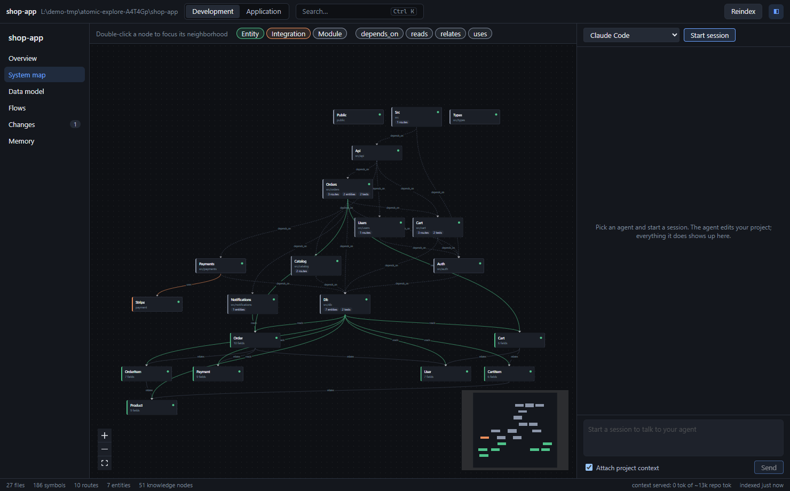
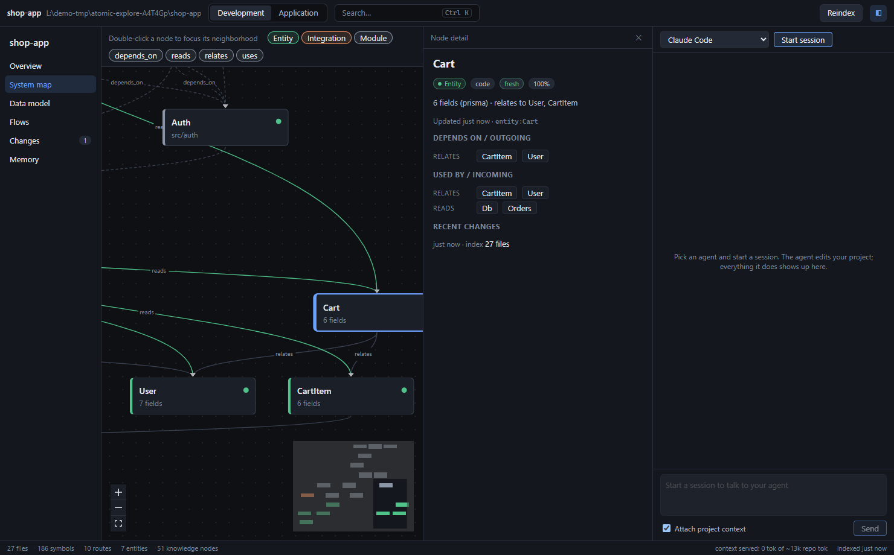
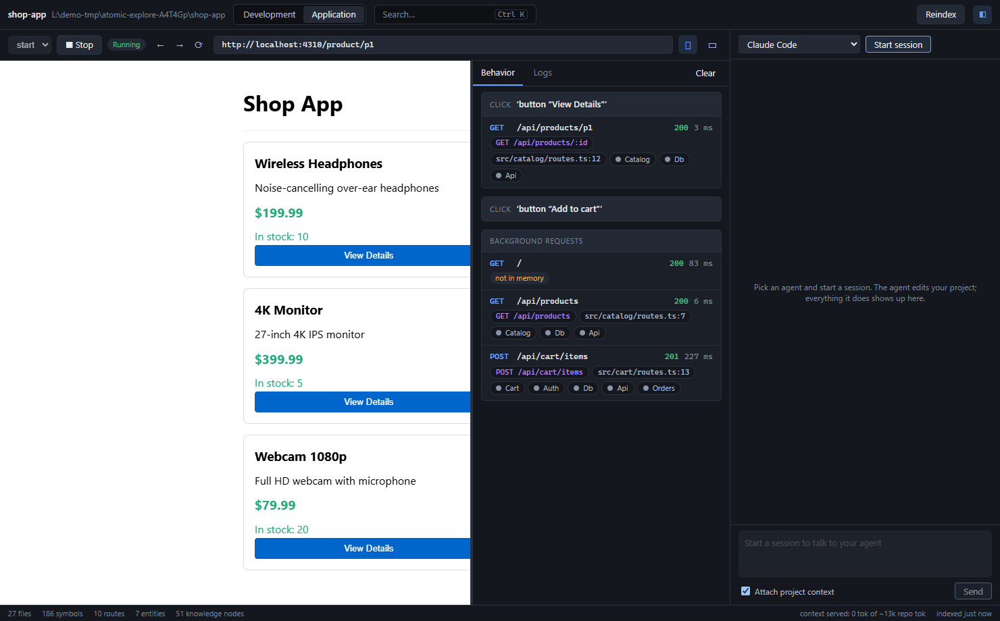
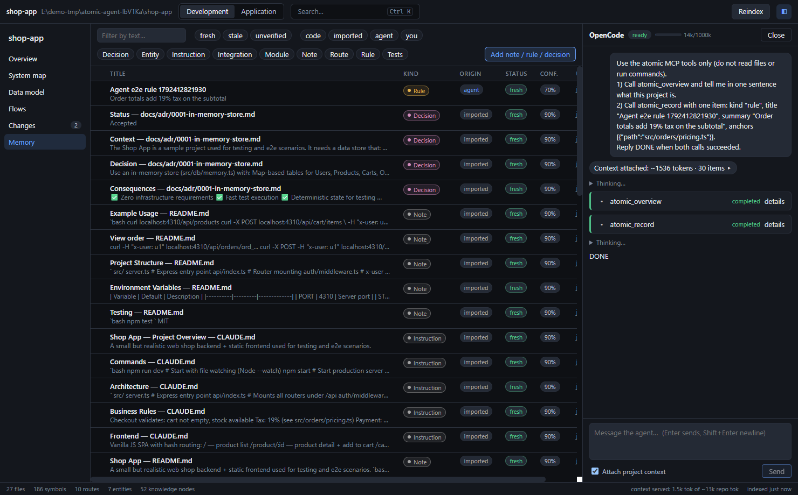
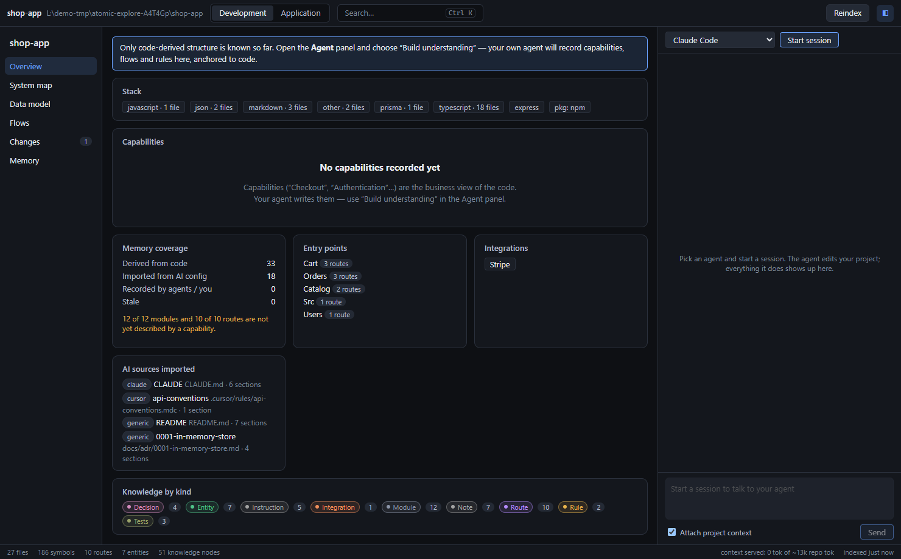

# Atomic Workspace

**A desktop workspace for AI-assisted development.** Bring your own coding agent (Claude Code, Codex, OpenCode, Gemini CLI or any ACP agent), let it work on your real project directory, and see the project as *software*: capabilities, flows, routes, data model, tests, and the impact of every change, instead of a pile of files and a chat log.

```
Developer  →  Workspace  ←  AI agent
```

The Workspace is **not** another AI and does not call a model itself. It is the bridge between you, a real agent, and the codebase, plus a persistent, local **project memory** that any agent can read and write.



## Why

AI agents are strong but amnesiac. Every session re-reads the repo, re-discovers the architecture and burns tokens on it. Meanwhile the developer only sees a transcript and a diff, with no map of *what the system is* or *what a change touches*.

Atomic Workspace fixes both sides:

- **For the agent:** a local memory it queries through MCP (`atomic_context`, `atomic_search`, `atomic_impact`…) so it pulls only what it needs, and writes back what it learned (`atomic_record`) once, for every future session and every other agent.
- **For the developer:** a rich UI over that same memory, plus the real agent running on the real directory.

## Features

### Development mode
- **System map**: modules, entities and integrations as an auto-laid-out graph (dagre). Click a node for its detail, double-click to focus its neighbourhood. Nodes touched by the agent's latest changes are highlighted.
- **Data model**: entities, fields and relations extracted from Prisma schemas and SQL.
- **Node detail**: what depends on it, what uses it, anchored files and recent changes.
- **Flows, Changes, Memory**: browse, filter and search everything known about the project, by origin (`code`, `imported`, `agent`, `you`) and freshness (`fresh`, `stale`, `unverified`).
- **Impact analysis**: given changed files, which capabilities, routes, entities and tests are affected.



### Application mode
Run the project's own dev script inside the Workspace and **click through the real app**. Every click is traced to the network request it caused, matched to the indexed route, the handler's `file:line`, and the modules involved.



*A click on "View Details" → `GET /api/products/:id` → `src/catalog/routes.ts:12` → Catalog, Db, Api.*

### Your agent, on your project
- Talks **ACP** (Agent Client Protocol), so agents keep their own tools, auth and configuration. The UI renders the structured stream: messages, thinking, tool calls, diffs, plans, permission requests, modes, usage.
- Files written by the agent are re-indexed incrementally and surface as a **change set** in the UI.
- The Workspace injects its **MCP server** into every session, so the agent can read and write project memory.
- The first prompt carries a compact overview pack; later prompts carry only task-relevant nodes not yet sent in that session.



*A real OpenCode session calling `atomic_overview` and `atomic_record`; the recorded rule appears in Memory, tagged `agent`.*

### Project memory
- A single SQLite file (`.atomic/memory.db`, WAL + FTS5) inside the project, **excluded from git automatically** via `.git/info/exclude` without touching your `.gitignore`.
- Three layers: **deterministic** (tree-sitter extraction, never stale), **imported** (your existing `CLAUDE.md`, `AGENTS.md`, `GEMINI.md`, Cursor / Windsurf / Copilot rules, skills, ADRs, READMEs), and **semantic** (recorded by *your* agent).
- Every non-deterministic node is **anchored to files by content hash**. Change an anchored file and only those nodes become `stale`; verifying them is a targeted refresh, not a re-analysis.



## How it works

```
┌────────────── Electron main ───────────────┐        ┌──── coding agent process ────┐
│ ProjectSession  (open, .atomic/, exclude)  │  ACP   │ opencode acp / claude-agent- │
│ Indexer (core)  scan → extract → derive    │◀──────▶│ acp / codex-acp / gemini     │
│ MemoryStore (core, node:sqlite WAL)        │ stdio  │   works on the REAL project  │
│ AgentManager  (ACP client, permissions)    │        │   dir with its own tools     │
│ AppRunner (dev script) + Tracer (webReq)   │        │        │ spawns              │
└───────▲────────────────────────────────────┘        │        ▼                     │
        │ IPC                                         │  atomic MCP server (stdio)   │
┌───────┴──────── renderer (React) ───────────┐       │  same .atomic/memory.db      │
│ Development: map · detail · data · memory   │       └──────────────────────────────┘
│ Application: webview · run · trace panel    │
│ Agent panel: timeline from raw ACP updates  │
└─────────────────────────────────────────────┘
```

Details and the reasoning behind each decision (and what was rejected) are in [docs/ARCHITECTURE.md](docs/ARCHITECTURE.md).

### MCP tools exposed to agents

| Tool | Purpose |
|---|---|
| `atomic_overview` | Project brief: stack, modules and capabilities, conventions, memory status |
| `atomic_context` | Relevant nodes and file/line ranges for a task, within a token budget |
| `atomic_search` | Full-text search over knowledge and symbols |
| `atomic_node` / `atomic_symbol` | Node detail with anchors and edges; symbol locations |
| `atomic_impact` | What a set of changed files affects |
| `atomic_record` | Record capabilities, flows, rules, entities and decisions, anchored to code |
| `atomic_stale` / `atomic_verify` | Re-verification loop for knowledge whose anchors changed |
| `atomic_unmapped` | Modules, routes and entities not yet covered by a capability |

The MCP server is a plain stdio process, so it also works outside the Workspace.

### Token efficiency by design
- Nothing is re-extracted unless its content hash changed; a file watcher drives incremental updates.
- The UI renders ACP updates and memory data directly: **zero LLM calls for presentation**.
- Agents pull context through MCP instead of re-exploring the repo.
- The semantic layer is built once by the agent you already pay for, then reused by every agent.
- The status bar shows context served vs. estimated repo tokens. *(Measured only on the small bundled fixture so far; treat it as an indicator, not a benchmark.)*

## Getting started

Requirements: **Node.js ≥ 22.13** (uses `node:sqlite`) and, for the agent panel, at least one agent installed and logged in.

```bash
git clone https://github.com/LucasGRPiovesan/atomic-workspace.git
cd atomic-workspace
npm install
npm run dev
```

Then **Open project folder**. Try it on the bundled sample: [`fixtures/shop-app`](fixtures/shop-app).

You can also launch straight into a project with `ATOMIC_PROJECT=/path/to/project npm run dev`.

### Agents

| Agent | How it is launched |
|---|---|
| Claude Code | bundled `@agentclientprotocol/claude-agent-acp` adapter |
| Codex | bundled `@agentclientprotocol/codex-acp` adapter |
| OpenCode | `opencode acp` from your `PATH` |
| Gemini CLI | `gemini --experimental-acp` from your `PATH` |
| Anything else | add an entry to `~/.atomic/agents.json`: `{ "id", "name", "command", "args", "env" }` |

The Workspace never stores or proxies credentials: each agent uses its own login.

## Security model

An agent is powerful, so the Workspace treats it as untrusted code that you invited:

- Agent file access (ACP `fs/*`) is **confined to the project directory**, including through symlinks, drive letters and UNC paths.
- Every permission request is shown to you; unknown options are rejected.
- The main window is **sandboxed** with context isolation. The embedded app webview gets only the tracing preload, no Node, no popups and no `file://` navigation.
- Importing existing MCP configs **redacts secrets** (tokens, keys, `Authorization` headers, URL credentials).
- `atomic_record` is bounded in size and count, validated inside the write transaction, and ids are namespaced by kind so an agent cannot squat on ids the indexer owns.

## Development

```bash
npm run typecheck      # core + desktop
npm test               # core unit tests (vitest)
npm run test -w @atomic/desktop   # desktop unit tests
npm run e2e            # build + Playwright (_electron) end-to-end suite
```

Verified on the current tree: core **149** tests, desktop **84** tests, Playwright e2e **3** scenarios (open project → system map → node detail; MCP write visible in Memory; Application mode click → route → `file:line`), sample app **36** tests, `tsc` clean. The agent loop was also verified end to end against a real OpenCode agent on a free model (`apps/desktop/e2e/agent-run.mjs`).

```
packages/core/       memory engine: extraction, detection, importers, store, indexer, context, MCP server
apps/desktop/        Electron app: main (ACP, runner, tracer), preload, React renderer, e2e
fixtures/shop-app/   realistic sample project used by tests and e2e
docs/                architecture and screenshots
```

**Stack:** Electron 44, electron-vite, React 19, TypeScript, `node:sqlite` (FTS5), tree-sitter (WASM), `@xyflow/react` + dagre, Agent Client Protocol SDK, Model Context Protocol SDK, Playwright, Vitest.

## Status and known limits

This is an early version (0.1). Honest list:

- Developed and tested on **Windows 11**. macOS and Linux are expected to work (no native compiled dependencies) but are **untested**.
- The real-agent loop is verified with **OpenCode**. The Claude Code and Codex adapters are wired and covered by a fake-ACP-agent test suite, but were not exercised against a live login in this repository.
- Route detection covers Express, Fastify, Koa, Hono, Next.js (app and pages), Flask, FastAPI, Spring and Nest. Entity extraction covers Prisma and SQL. Other ORMs are not parsed yet.
- Indexing performance has been measured on the 27-file fixture only, not on large monorepos.
- Concurrent writes from several MCP processes rely on SQLite WAL and `BEGIN IMMEDIATE` transactions; there is no multi-process stress test yet.

## How it was built

The project was designed and reviewed by an AI tech lead (Claude) that **orchestrated delegated workers** rather than writing everything in one context. Each delegated task got an explicit spec, and a worker's "done" was treated as a claim: diffs were read, acceptance checks re-run, risky areas (security, data integrity) were done or independently reviewed by the lead, and several worker outputs were rejected or fixed. The test suites and the end-to-end checks are the evidence, not the workers' own reports.

## License

No license has been chosen yet; all rights reserved until one is added.
